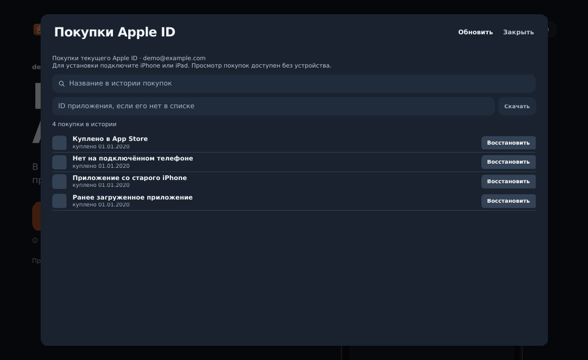

# ReVivo

Версия 0.4.0.

Бесплатное настольное приложение для macOS и Windows: восстановление сгруженных
и ранее приобретённых iOS-приложений на iPhone/iPad, работа с собственной библиотекой IPA.
Тёмный интерфейс, без подписки, оплаты и собственного сервера аккаунтов.

**[Полное руководство на русском: устройство проекта, Apple ID, безлимит и сборка](docs/REVIVO-GUIDE-RU.md)**

**[Аудит передачи данных и оплаты](docs/REVIVO-NETWORK-AUDIT-RU.md)**



## Быстрый запуск из исходников

Требуется Python 3.10–3.13 (рекомендуется 3.12).

```bash
python -m venv .venv
# macOS: source .venv/bin/activate
# Windows PowerShell: .venv\Scripts\Activate.ps1
python -m pip install -e '.[gui]'
python -m apprestore_gui --ui quick
```

Для входа в Apple ID и скачивания нужен локально собранный **патченный ipatool**;
инструкции и установка бинарника — в полном руководстве. На Windows нужны драйверы
Apple Mobile Device / Apple Devices, на macOS — доверие к компьютеру на устройстве.

Для macOS упаковщик дополнительно создаёт `ReVivo-macOS.dmg` с установкой
перетаскиванием в Программы. Ключи Apple для создания образа не требуются;
[предупреждение Gatekeeper и первый запуск](docs/REVIVO-MACOS-DMG-RU.md).

## Что умеет

- Находит подключённые устройства и сгруженные приложения.
- Восстанавливает из подходящего IPA или загружает доступное приложению Apple ID.
- Показывает историю покупок, локальные IPA, поиск App Store и встроенный каталог.
- Перед добавлением новой бесплатной лицензии показывает согласие.
- Не приобретает платные приложения. Доступность и лицензии определяет Apple.

## Приватность и бесплатность

Нет серверной админки, тарифов и выдачи платного «безлимита». Проверены исходники:
платёжных реквизитов и обработчиков оплаты не обнаружено.

Необязательные сторонние HTTP-сервисы отключены политикой
`apprestore_core/network_policy.py`: Internet Archive, IPA Filezone,
Brave/DuckDuckGo, Google favicon. Сетевые метаданные и изображения идут к Apple;
обновления — из `amwbru-alt/AppRestore`, а не из репозитория исходного автора.
Вход Apple ID и загрузка IPA выполняются нативным ipatool напрямую через Apple.

По умолчанию сохранена локальная квота добавления новых бесплатных лицензий:
5 за 24 часа и 15 всего. Восстановление уже приобретённых приложений в эту квоту
не входит. Владелец может отключить только эту локальную квоту через
`REVIVO_UNLIMITED_LICENSES=1`; подробности в руководстве.

## Разработка

Внутренние Python-пакеты, команды `apprestore` / `apprestore-gui` и переменные
`APPRESTORE_*` сохранены для совместимости. Дополнительно доступны `revivo` и
`revivo-gui`. Графическое приложение, бинарники и GUI ZIP называются ReVivo.

```bash
python -m pip install pytest -r requirements/gui-build.txt
QT_QPA_PLATFORM=offscreen python -m pytest -q
```

Для PowerShell: сначала `$env:QT_QPA_PLATFORM = 'offscreen'`, затем `python -m pytest -q`.
GUI build запускается вручную в GitHub Actions и собирает Windows/macOS отдельно.

## Происхождение и лицензия

ReVivo — модифицированная версия [AppRestore от J3ckJ](https://github.com/J3ckJ/AppRestore).
Сохранены GPL-3.0-or-later, уведомления и лицензии зависимостей: [LICENSE](LICENSE),
[THIRD_PARTY_NOTICES.md](THIRD_PARTY_NOTICES.md).
При распространении сборки предоставляйте соответствующие исходники по GPL.
Исторические документы и CHANGELOG описывают также исходную версию; актуальные
отличия этого форка перечислены в руководстве ReVivo.
